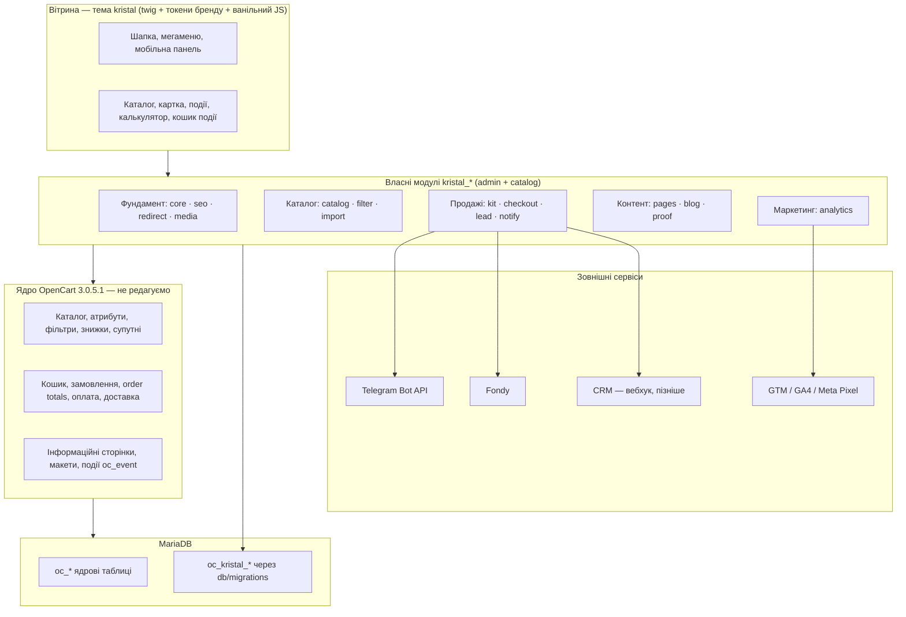

# «Крістал» — архітектура і план реалізації на OpenCart

Nov 6, 2026 · @Volodymyr

## Резюме

Сайт будуємо на **ядрі OpenCart без сторонніх модулів з маркетплейсів**. Усе, чого бракує ядру для оренди (ціна за добу, комплекти, калькулятор, кошик події, ліди, SEO, редиректи, блог), робимо **власними модулями `kristal_*`** на подіях OpenCart, з мінімумом OCMOD. Єдиний зовнішній код, що лишається, — офіційний платіжний модуль Fondy від самого провайдера, після рев'ю.

Ключові рішення:

1. **Платформа:** оновити 3.0.3.2 → **OpenCart 3.0.5.1** і перевести прод на **PHP 8.2/8.3** на ранньому етапі (до теми), а не наприкінці. Версії 3.0.5.1 і 4.1.0.4 вийшли в серпні 2026 з підтримкою PHP 8.5.
2. **Архітектура:** ядро не чіпаємо → 16 власних модулів `kristal_*` + тема `kristal` + власні таблиці `oc_kristal_*` через міграції.
3. **Ядро використовуємо максимально:** категорії, атрибути, фільтри, знижки за кількість, мінімальна кількість, супутні товари, групи клієнтів, інформаційні сторінки, макети, статуси замовлень, купони, order totals.
4. **Порядок:** платформа і фундамент → каталог → конверсія (ліди, комплекти, кошик події) → контент і SEO → запуск з 301 → пост-запуск (календар наявності, CRM).
5. **Термін:** \~15–17 тижнів до запуску при одному розробнику з агентами; контент і фото від клієнта — паралельно, це головний ризик строку.

## 1. Принципи і що вважаємо «сумнівним модулем»

| Категорія коду | Дозволено? | Правило |
| --- | --- | --- |
| Ядро OpenCart 3.0.5.1 з офіційного GitHub | Так | Не редагуємо. Оновлення — перезаписом файлів ядра |
| Офіційні модулі платіжних провайдерів (Fondy, за потреби monobank / LiqPay) | Так, після рев'ю | Беремо лише з офіційного репозиторію провайдера, читаємо код перед встановленням, фіксуємо версію |
| Модулі з маркетплейсів, nulled, «безкоштовні з форуму», ionCube-закодовані | **Ні** | Замінюємо власною реалізацією |
| Власні модулі `kristal_*` | Так | Через SDD: spec → plan → tasks, правила AGENTS.md |
| JS/CSS-бібліотеки | Лише за обґрунтуванням у plan.md | Вітрина — ванільний JS без jQuery-плагінів; адмінка — jQuery/Bootstrap ядра |
| PHP-бібліотеки (Composer) | Виняток, окреме рішення | Наприклад, генерація PDF — тільки якщо ручне завантаження PDF не підійде |

### Аудит того, що вже встановлено

| Що є зараз | Походження | Рішення |
| --- | --- | --- |
| `module/notifications_in_telegram` | Сторонній модуль | **Замінити** на `kristal_notify`, видалити після перемикання |
| `payment/oplata` (Fondy) | Платіжний провайдер | Залишити; звірити з актуальною версією з офіційного репозиторію Fondy, перевірити на PHP 8.x |
| Тема `sauco` + `system/tweak.ocmod.xml` | Сторонній шаблон | Прибрати після запуску теми `kristal` (спека 003) |
| `feed/google_sitemap` | Ядро | Замінити власним sitemap у `kristal_seo` (ядровий не знає наших сторінок і блогу) |
| `analytics/google` | Ядро | Вимкнути, аналітика через GTM у `kristal_analytics` |
| `shipping/flat, free, pickup`, `payment/cod` | Ядро | Перевикористати: самовивіз, доставка; «заявка без оплати» — власний `payment/kristal_request` |
| ionCube у Docker-образі | Залежність старих модулів | Після видалення `sauco` і стороннього Telegram-модуля перевірити, чи потрібен; якщо ні — прибрати |

## 2. Платформа: 3.0.5.1, а не 4.1

| Критерій | OpenCart 3.0.5.1 | OpenCart 4.1.0.4 |
| --- | --- | --- |
| Перенесення бази й URL | Перезапис файлів, схема майже та сама | Повна міграція даних і SEO URL |
| Вже зроблена робота (001, інфраструктура, AGENTS.md) | Лягає як є | Переписувати |
| PHP 8.x | Так (до 8.4, 3.0.5.1 — 8.5) | Так |
| Аргумент «багато готових модулів під 3.0» | Неважливий: стороннє не ставимо | — |
| Довгострокова підтримка | Гілка жива, але стара архітектура | Новіша архітектура, менше знайомих рішень |

**Рекомендація: 3.0.5.1.** Перехід на 4.x лишаємо окремим проєктом на потім: власні модулі на подіях переносяться відносно легко.

Як оновлюємо (нова спека **018 — Платформа**, ставимо одразу після 001):

1. Локально в Docker: перезаписати ядро файлами 3.0.5.1, прогнати офіційний upgrade-скрипт на копії бази, `make db-schema-diff` → оформити різницю як міграцію.
2. Docker-образ перевести на PHP 8.2 (той самий, що буде на проді); `make lint` — проти 7.3 **і** 8.2, поки прод не перемкнуто.
3. Зібрати й прибрати deprecations PHP 8 у логах (динамічні властивості, `null` у вбудовані функції).
4. На HOSTiQ у cPanel перевірити вибір PHP 8.2/8.3 і **GD з WebP** — без цього не буде WebP (модуль `kristal_media`).
5. Прод: бекап → файли через `make deploy` → SQL через phpMyAdmin → перемкнути PHP → smoke.

Після перемикання прода правило «PHP 7.3» в AGENTS.md змінюється на «PHP 8.2».

## 3. Архітектура



### Як модулі вбудовуються в OpenCart (без правок ядра)

| Механізм | Коли застосовуємо | Приклади |
| --- | --- | --- |
| **Події `oc_event`** (основний) | Додати дані у сторінку, зреагувати на збереження, підмінити шаблон | `view/product/product/before` — додати поля оренди; `model/catalog/product/editProduct/after` — зберегти вкладку «Оренда»; `model/checkout/order/addOrderHistory/after` — сповіщення |
| **Власні маршрути** `extension/kristal/*` | Нові сторінки й AJAX | калькулятор, кошик події, форми, блог, sitemap |
| **Розширення ядрових типів** | Там, де OpenCart має точку розширення | `total/kristal_rental_days`, `total/kristal_kit_discount`, `payment/kristal_request`, `module/kristal_*` для позицій макета |
| **OCMOD** (виняток) | Тільки де подій немає | `startup/seo_url` (стартові дії не проходять через події), можливо пошук. Кожен OCMOD — окремим пунктом у plan.md |
| **Бібліотека** `system/library/kristal/` | Спільний код | Telegram-клієнт, JSON-LD, антиспам, форматування цін |

### Структура файлів одного модуля

```
src/
├── admin/controller/extension/module/kristal_lead.php     # налаштування, install/uninstall (реєстрація подій)
├── admin/controller/extension/kristal/lead.php            # список заявок
├── admin/model/extension/kristal/lead.php
├── admin/view/template/extension/kristal/lead_list.twig
├── admin/language/uk-ua/extension/kristal/lead.php
├── catalog/controller/extension/kristal/lead.php          # submit, thank-you
├── catalog/model/extension/kristal/lead.php
├── catalog/language/uk-ua/extension/kristal/lead.php
├── catalog/view/theme/kristal/template/extension/kristal/lead_form.twig
└── system/library/kristal/antispam.php
db/migrations/00NN_kristal_lead.up.sql / .down.sql
specs/0NN-lead-forms/{spec,plan,tasks}.md
```

Домовленості: `install()` модуля реєструє свої події та права, `uninstall()` — прибирає; таблиці — тільки міграціями (не в `install()`), щоб відкат був передбачуваним.

## 4. Модулі

16 модулів + тема. Номер спеки — з беклогу; нові позначені **нов.**

### Фундамент

| Модуль | Що робить | Ядро / власне | Спека |
| --- | --- | --- | --- |
| `kristal_core` | Спільні налаштування (NAP: назва, адреса, телефони, графік, месенджери, соцмережі), бібліотека: антиспам (CSRF, honeypot, time-trap, ліміт частоти), Telegram-клієнт на cURL, JSON-LD білдер, логування без персональних даних, ключі кешу `kristal.*` | Власне | **нов. 019** |
| `kristal_seo` | ЧПУ для всіх маршрутів (інформація, події, блог, наші сторінки), окреме поле H1 і SEO-текст для категорій/товарів/сторінок, шаблони title/description з підстановками (`{name}`, `{min_price}`), canonical для фільтрів/сортування/пагінації, `noindex` для кошика, пошуку, кабінету, sitemap.xml з кешем, robots.txt, JSON-LD: `LocalBusiness`, `Organization`, `BreadcrumbList`, `Product`/`Offer` | Ядро: `oc_seo_url`, meta-поля. Власне: H1, шаблони, sitemap, розмітка | 011 |
| `kristal_redirect` | Таблиця 301 (старий шлях → новий), імпорт CSV, лічильник переходів, журнал 404 для пошуку пропущених адрес. Обробка — до `seo_url` | Власне | 002 |
| `kristal_media` | WebP-копії при ресайзі (подія `model/tool/image/resize/after` + GD `imagewebp`), `srcset`, `width/height`, `fetchpriority` для LCP-зображення | Ядро: `model/tool/image`. Власне: WebP, srcset | **нов. 020** (частина 016) |

### Каталог оренди

| Модуль | Що робить | Ядро / власне | Спека |
| --- | --- | --- | --- |
| `kristal_catalog` | Вкладка «Оренда» в картці товару в адмінці: одиниця («шт», «комплект», «м²»), ціна за добу (= ціна ядра), застава, вартість биття/втрати, миття включено, позначка «Хіт». Вивід у картці й у списку: ціна/добу, мін. кількість, таблиця знижок «від 100 шт», «З цим беруть». Пошук з автопідказками | Ядро: `price`, `minimum`, `product_discount`, `product_related`, атрибути (матеріал, розмір, об'єм). Власне: `oc_kristal_product_rental` | 005 |
| `kristal_filter` | Фільтри категорії (тип, матеріал, колір, стиль, об'єм, ціна) з лічильниками, AJAX без перезавантаження. SEO-сторінки лише для білого списку комбінацій (напр. «білі тарілки») з власним title/H1/текстом; решта комбінацій — canonical на категорію | Ядро: групи фільтрів `oc_filter`, `oc_product_filter`. Власне: UI, лічильники з кешем, `oc_kristal_filter_page` | **нов. 021** |
| `kristal_import` | Імпорт/оновлення прайсу з CSV (за артикулом): ціни, мін. кількість, застава, биття, знижки, наявність. Режим «показати зміни» перед записом, журнал імпортів. Клієнт віддає прайс таблицею — без імпорту сотні позицій вручну не завести | Власне, без бібліотек (CSV; XLSX клієнт зберігає як CSV) | **нов. 022** |

### Продажі та ліди

| Модуль | Що робить | Ядро / власне | Спека |
| --- | --- | --- | --- |
| `kristal_kit` | **Комплекти** (базовий / стандарт / преміум × подія) і **калькулятор події** на одному рушії норм: «на гостя» для формату (банкет / фуршет / кава-брейк) × кількість страв, округлення до упаковки. Ціна комплекту рахується з поточних цін товарів (ціни не дублюються). «Все в кошик» додає позиції звичайними товарами; «Надіслати менеджеру» створює лід | Ядро: кошик. Власне: `oc_kristal_kit`, `oc_kristal_kit_item`, `oc_kristal_calc_norm`; знижка комплекту — `total/kristal_kit_discount` | 007, 008 |
| `kristal_checkout` | **Кошик події** на одній сторінці: дати отримання і повернення, доставка/самовивіз, адреса, контакт, коментар, реквізити юрособи (ЄДРПОУ, назва) і рахунок. Режими: «заявка без оплати» (`payment/kristal_request`, статус «Нова заявка») або передоплата через Fondy. Множник за кількість діб — `total/kristal_rental_days` з таблицею коефіцієнтів в адмінці. Дати й реквізити видно в замовленні в адмінці | Ядро: `model/checkout/order`, оплата, доставка, order totals. Власне: маршрут, `oc_kristal_order_rental`, `oc_kristal_rental_coef` | 010 |
| `kristal_lead` | Форми: «Розрахунок за 15 хв» (дата, гості, телефон, файл меню), «Замовити в 1 клік», зворотний дзвінок, прайс за email, B2B-запит. Файли — у `storage/upload`, білий список розширень і ліміт розміру. Список заявок в адмінці зі статусами, експорт CSV. UTM і сторінка-джерело. Сторінка «Дякуємо» для аналітики | Власне: `oc_kristal_lead`, `oc_kristal_lead_file` | 009 |
| `kristal_notify` | Сповіщення про ліди й замовлення в Telegram (кілька чатів), email менеджеру через пошту ядра; вебхук JSON з HMAC-підписом для майбутньої CRM. Повтор при збої, журнал відправок | Власне: `oc_kristal_notify_log`. Замінює `notifications_in_telegram` | **нов. 023** (виділено з 009) |

### Контент і довіра

| Модуль | Що робить | Ядро / власне | Спека |
| --- | --- | --- | --- |
| `kristal_pages` | Посадкові **подій** і **послуг**, «Умови оренди», «Для бізнесу», «Ціни», «Контакти», «Про нас» — інформаційні сторінки ядра з власним шаблоном і блоками: hero, комплекти, категорії, галерея, відгуки, FAQ, форма. Шаблон підставляється подією `view/information/information/before`. FAQ-блоки для будь-якої сутності + `FAQPage`, `Service` | Ядро: `oc_information`, макети. Власне: `oc_kristal_page`, `oc_kristal_faq` | 006, 012 |
| `kristal_blog` | Статті, рубрики, пагінація, ЧПУ, автор/дата, посилання на категорії й комплекти, `Article` JSON-LD, у sitemap | Власне: `oc_kristal_blog_post`, `_category`, `_post_to_category`, `_post_related` | 013 |
| `kristal_proof` | **Портфоліо** (подія, формат, гості, галерея, використані товари) і **відгуки** (текст, ім'я, джерело Google + посилання, дата). `AggregateRating` — тільки з відгуків, зібраних на сайті | Ядро: відгуки до товарів. Власне: `oc_kristal_case`, `oc_kristal_case_image`, `oc_kristal_testimonial` | 014 |

### Маркетинг і пізніше

| Модуль | Що робить | Спека |
| --- | --- | --- |
| `kristal_analytics` | GTM з відкладеним завантаженням, банер згоди (Consent Mode v2), `dataLayer`: `view_item`, `add_to_cart`, `begin_checkout`, `purchase`, `generate_lead`, клік на `tel:`, Viber, Telegram. Meta Pixel — через GTM | 015 |
| `kristal_availability` (після запуску) | Календар зайнятості: бронювання на дати з замовлень, наявність = склад − перетин бронювань, попередження в кошику | **нов. 024** |
| Тема `kristal` | Каркас, токени бренду, шапка з мегаменю (кеш), мобільна нижня панель, футер, компоненти (картка, плитка, форма, FAQ), 404, «Дякуємо», cookie-банер. Без jQuery на вітрині | 003, 004 |

## 5. Модель даних

Усі таблиці — `InnoDB`, `utf8mb4_general_ci`, первинний ключ, префікс `oc_kristal_`, лише через `db/migrations` з `down`. Індекси нижче — стартові, кожен гарячий запит підтверджуємо `make db-explain`.

| Таблиця | Ключові поля | Індекси |
| --- | --- | --- |
| `kristal_product_rental` | `product_id` PK, `unit`, `deposit`, `breakage_price`, `washing_included`, `is_hit` | PK; `idx_is_hit` для блоку «Хіти» |
| `kristal_seo_meta` | `entity_type`, `entity_id`, `language_id`, `h1`, `seo_text`, `meta_template` | PK(`entity_type`, `entity_id`, `language_id`) |
| `kristal_redirect` | `redirect_id`, `old_path` (хеш + текст), `new_path`, `code`, `hits`, `last_hit_at` | `uq_old_path_hash` |
| `kristal_404_log` | `path_hash`, `path`, `hits`, `last_at` | `uq_path_hash`, `idx_hits` |
| `kristal_filter_page` | `category_id`, `filter_ids` (відсортований рядок), `keyword`, `h1`, `title`, `description`, `text` | `uq_category_filters`, `uq_keyword` |
| `kristal_kit` / `kristal_kit_item` | `kit_id`, `event_type`, `tier`, `guests`, `discount_pct` / `kit_id`, `product_id`, `qty_per_guest`, `qty_fixed` | `idx_event_tier`; PK(`kit_id`, `product_id`), `idx_product_id` |
| `kristal_calc_norm` | `format`, `product_id`, `qty_per_guest`, `per_course`, `pack_size` | PK(`format`, `product_id`) |
| `kristal_rental_coef` | `days` PK, `coef` | PK |
| `kristal_order_rental` | `order_id` PK, `date_from`, `date_to`, `days`, `delivery_type`, `company_name`, `edrpou` | PK; `idx_date_from` (для календаря) |
| `kristal_lead` (+ `_file`) | `lead_id`, `type`, `status`, `name`, `phone`, `email`, `event_date`, `guests`, `comment`, `source_url`, `utm_*`, `created_at` | `idx_status_created`, `idx_created` |
| `kristal_notify_log` | `id`, `channel`, `entity`, `entity_id`, `status`, `attempts`, `created_at` | `idx_status_attempts` |
| `kristal_page` / `kristal_faq` | `information_id` PK, `template`, `hero_image`, `blocks` (JSON) / `faq_id`, `entity_type`, `entity_id`, `sort` | `idx_entity` (`entity_type`, `entity_id`, `sort`) |
| `kristal_blog_*` | пост, рубрика, зв'язки | `idx_status_date`, PK на зв'язках + зворотні індекси |
| `kristal_case*`, `kristal_testimonial` | кейси, фото, відгуки | `idx_status_sort` |
| `kristal_reservation` (пізніше) | `product_id`, `order_id`, `date_from`, `date_to`, `qty` | `idx_product_dates` (`product_id`, `date_from`, `date_to`) |

Телефони й email у `kristal_lead` — персональні дані: не логуємо, доступ в адмінці лише з правом `access` на модуль, автоочищення старих заявок за налаштуванням (наприклад, 24 міс.).

### Що ядро OpenCart дає без доробок

| Потреба з концепції | Рішення ядром |
| --- | --- |
| Знижка за обсяг | «Знижки» товару (кількість → ціна) |
| Мінімальна кількість | Поле «Мінімальна кількість» |
| «З цим беруть» | «Рекомендовані товари» (`product_related`) |
| Умови для агенцій / кейтерингів | Групи клієнтів «Агенція», «Кейтеринг» з власними цінами («Спеціальні» / «Знижки» на групу) |
| Промокод на наступну подію | Купони ядра |
| Характеристики в картці | Атрибути |
| Статуси заявки | Статуси замовлень: «Нова заявка», «Підтверджено», «Видано», «Повернено», «Закрито» |
| Самовивіз / доставка | `shipping/pickup`, `shipping/flat` (тарифи зон — пізніше власним `shipping/kristal_zone`, якщо клієнт дасть зони) |

## 6. Інфраструктура, середовища, якість

| Середовище | Де | Для чого |
| --- | --- | --- |
| Локальне | Docker (вже є): PHP 8.2 після 018, MariaDB, Adminer, Mailpit | Розробка, мок-дані |
| Staging (**нов. 025**) | Піддомен на HOSTiQ, закритий паролем і `noindex`, окрема база | Показ клієнту, приймання, перевірка 301 і швидкості на реальному хостингу |
| Прод | orendaposydy/orendaposudu (домен вирішити) | Тільки `make deploy` → підтвердження → `make deploy-apply` |

Якість — як в AGENTS.md: `make verify` (lint, аудит БД, міграції, smoke, мобільний аудит), EXPLAIN для кожного запиту, бюджети запитів на сторінку. Додати до інструментів:

- `make lint` проти двох версій PHP на перехідний період;
- smoke для кожного модуля (URL у `tests/smoke/urls.txt`, редиректи у `redirects.txt`);
- для форм і кошика — сценарний тест Playwright (вже є в `tests/mobile`): заповнити форму → лід у базі → повідомлення в Telegram-тестовому чаті;
- щоденний бекап бази й файлів на проді (cron cPanel) + перевірка відновлення раз на місяць.

## 7. Дорожня карта

Оцінки — для одного розробника з агентами; найбільше на строк впливають ціни й фото від клієнта.

| Фаза | Тижні | Спеки (порядок) | Результат |
| --- | --- | --- | --- |
| **0. Інфраструктура** | 1 (в роботі) | 000, 001 | Правила, міграції, мок-каталог |
| **1. Платформа і фундамент** | 2–4 | 018 платформа → 017 безпека → 019 `kristal_core` → 003 тема (каркас) → 020 медіа | OC 3.0.5.1 на PHP 8.2 локально й на staging, тема з шапкою/футером/мобільною панеллю, WebP |
| **2. Каталог** | 5–7 | 005 `kristal_catalog` → 021 фільтри → 022 імпорт → 004 головна | Категорії й картки з ціною/добу, заставою, знижками; клієнт може завантажити прайс |
| **3. Конверсія** | 8–11 | 023 `kristal_notify` → 009 ліди → 010 кошик події → 007 комплекти → 008 калькулятор | Заявки й замовлення з дат оренди падають у Telegram; комплекти й калькулятор кладуть у кошик |
| **4. Контент і SEO** | 11–14 | 011 SEO → 002 редиректи → 006 події → 012 сторінки → 014 портфоліо/відгуки → 013 блог | Посадкові подій і послуг, sitemap, розмітка, 301 зі старих адрес, перші статті |
| **5. Запуск** | 15–16 | 015 аналітика → 016 швидкість → 025 staging-приймання → реліз | Перевірені 301, PageSpeed на мобільному в бюджеті, GA4 і GTM, Search Console, видалено `install/`, перейменовано `admin/` |
| **6. Після запуску** | 17+ | 024 календар наявності, CRM, англійська версія, зони доставки | За даними перших місяців |

Контрольні точки з клієнтом: кінець фази 1 (дизайн теми на staging), кінець фази 2 (реальний каталог), кінець фази 3 (тестова заявка від клієнта), перед фазою 5 (згода на запуск).

### Зміни в `specs/BACKLOG.md`

| # | Що | Чому |
| --- | --- | --- |
| 018 | Платформа: OC 3.0.5.1 + PHP 8.2 | Раніше було частиною 016 наприкінці; переносимо на початок, щоб не писати код під EOL-версію |
| 019 | `kristal_core`: налаштування NAP, бібліотека, антиспам | Від нього залежать усі форми й розмітка |
| 020 | `kristal_media`: WebP, srcset | Мобільні бюджети не тримаються без WebP |
| 021 | `kristal_filter` + SEO-сторінки фільтрів | У концепції був «модуль фільтра» — робимо свій |
| 022 | `kristal_import`: прайс з CSV | Без нього каталог не наповнити |
| 023 | `kristal_notify`: Telegram, email, вебхук | Заміна стороннього модуля |
| 024 | `kristal_availability`: календар | Пост-запуск |
| 025 | Staging і чек-лист запуску | Приймання на реальному хостингу |

## 8. Ризики

| Ризик | Ймовірність | Що робимо |
| --- | --- | --- |
| Клієнт довго не дає ціни й фото | Висока | Мок-режим, імпорт CSV, шаблон прайсу клієнту вже на фазі 1; запуск не раніше, ніж заповнено топ-категорії |
| HOSTiQ не дає PHP 8.2 або GD без WebP | Низька–середня | Перевірити в cPanel на фазі 1; запасний план — WebP генерувати локально при деплої зображень |
| Втрата трафіку при зміні URL | Середня | Повна таблиця 301, smoke `redirects.txt`, моніторинг 404-журналу перші 4 тижні, Search Console |
| Деплой лише через FTP | Середня | Бекап перед кожним деплоєм, dry-run, SQL через phpMyAdmin, staging як репетиція |
| Обсяг 16 власних модулів | Середня | Порядок за цінністю: каталог і ліди дають заявки раніше за блог і портфоліо; блог і календар можна після запуску |
| Fondy-модуль не працює на PHP 8.x | Низька | Перевірити на 018; оновити з офіційного репозиторію або тимчасово «заявка без оплати» |
| Подвійне бронювання без календаря | Середня | До 024 менеджер підтверджує наявність вручну — це вже закладено в сценарій «заявка → підтвердження» |

## 9. Рішення, які потрібні зараз

- [ ] Затвердити **OpenCart 3.0.5.1** (а не 4.1) і перенесення оновлення платформи на початок.
- [ ] Основний домен: orendaposudu.com чи orendaposydy.com (впливає на 301, Search Console, GBP).
- [ ] Залишаємо Fondy? Потрібен monobank / LiqPay?
- [ ] Куди йдуть заявки: лише Telegram на старті чи одразу CRM (яка)?
- [ ] Чи є послуга миття посуду, зони й тарифи доставки, коефіцієнти за кількість діб оренди.
- [ ] Хто вносить контент: менеджер клієнта через адмінку чи ми з таблиць.

Повний список даних від клієнта — у документі «Концепція сайту «Крістал» на OpenCart», розділ «Що потрібно від клієнта».
